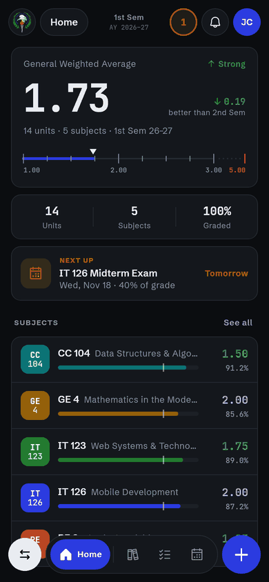
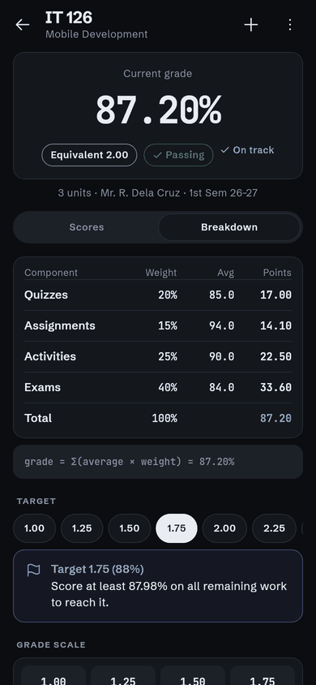
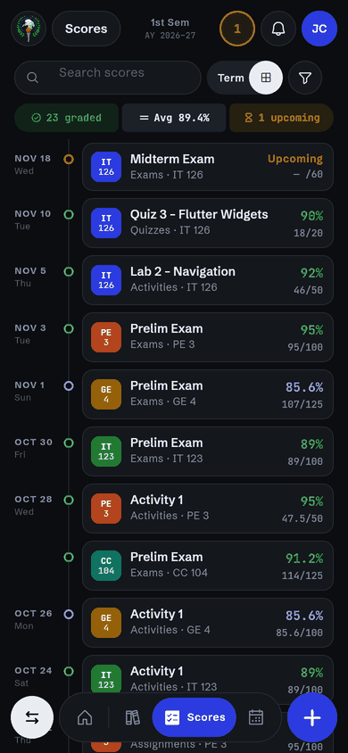
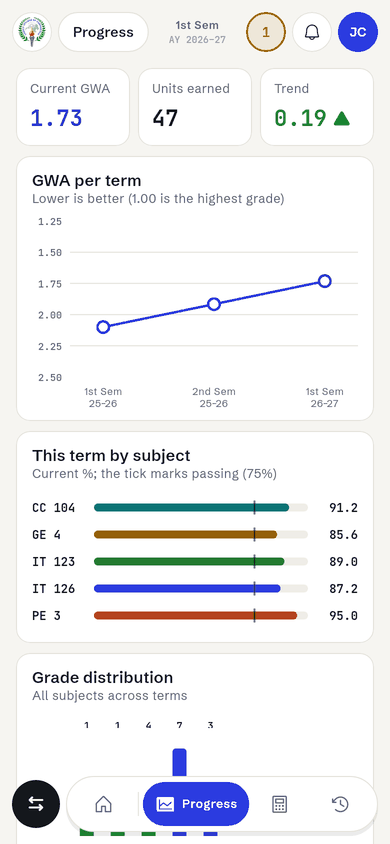
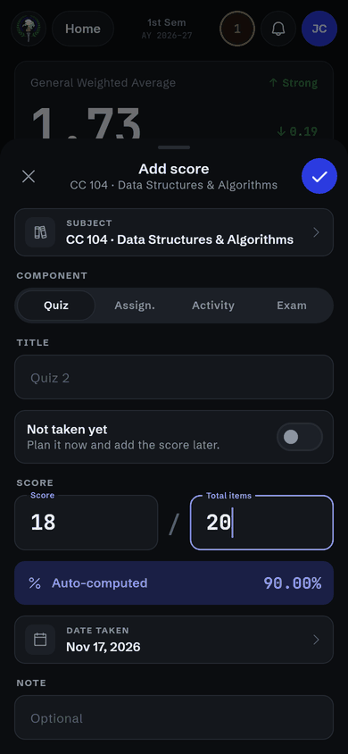
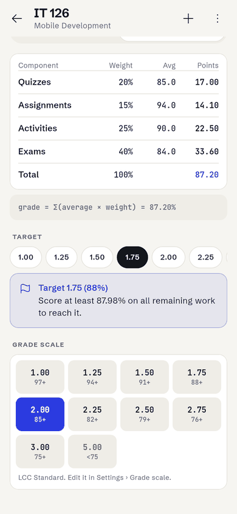
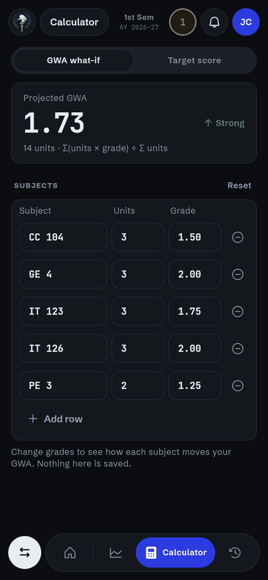
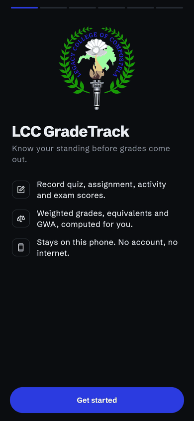

# LCC GradeTrack

Grade tracker for students of Legacy College of Compostela. Record quiz, assignment, activity and exam scores; the app computes component averages, weighted subject grades, 1.00–5.00 equivalents and the units-weighted GWA. Everything is stored on the phone.

Android · Flutter 3.50 · Dart 3.14 · SQLite (sqflite) · no network access.

<p>
  
  
  
  
</p>
<p>
  
  
  
  
</p>

## Features

| Area | What it does |
|---|---|
| Profile and lock | Local profile (name, student no., program, year). Optional 4-digit PIN (salted, iterated SHA-256) and fingerprint unlock. Relocks after a set time away. |
| Terms | Semesters by school year (1st, 2nd, Summer). One current term drives Home, Subjects and Scores. |
| Subjects | Code, title, units, instructor, color. Grading components with weights that must total 100%. Per-subject averaging method and grade scale. Final grade or INC / DRP / W from the registrar. |
| Scores | Score and total items, auto-computed percent, date, note. Assessments can be planned before they happen (no score yet). |
| Grade engine | Component average → weighted subject percent → equivalent → units-weighted GWA. In-progress grades are normalized over the graded weight. |
| Target | Minimum percent needed on all remaining work to reach a chosen equivalent. |
| Planner and reminders | Upcoming assessments grouped by urgency; optional local notifications N days before. |
| Progress and history | GWA per term (lower is better), current percent by subject, grade distribution, cumulative GWA and units earned. |
| Calculator | GWA what-if with editable rows; target score per subject. Nothing is saved. |
| Data | JSON backup and restore, CSV of all scores, PDF grade report per term, sample semester, delete all. |

## Grade computation

Worked example from the project proposal (IT 126):

| Component | Weight | Average | Points |
|---|---:|---:|---:|
| Quizzes | 20% | 85.0 | 17.00 |
| Assignments | 15% | 94.0 | 14.10 |
| Activities | 25% | 90.0 | 22.50 |
| Exams | 40% | 84.0 | 33.60 |
| **Total** | 100% | | **87.20** → 2.00 |

GWA = Σ(units × grade) ÷ Σ units = 24.25 ÷ 14 = **1.73**.

Default scale (LCC Standard, editable in Settings › Grade scale):

| Min % | 97 | 94 | 91 | 88 | 85 | 82 | 79 | 76 | 75 | below 75 |
|---|---|---|---|---|---|---|---|---|---|---|
| Grade | 1.00 | 1.25 | 1.50 | 1.75 | 2.00 | 2.25 | 2.50 | 2.75 | 3.00 | 5.00 |

Rules:
- Component average: mean of item percentages (default) or total points ÷ total items.
- Subject percent is rounded before conversion: 2 decimals (default), none, or whole number.
- Subjects marked INC, DRP or W, or set to not count (e.g. NSTP), are left out of the GWA.
- A registrar's final grade replaces the computed one.

The engine is pure Dart in `lib/core/services/` and is covered by unit tests that reproduce the table above.

## Architecture

Follows the proposal's three layers (slide 22) and the navigation structure of theria-FinanceApp.

```
lib/
  main.dart, app.dart, router.dart   app start, theme, lock overlay, go_router routes
  ui.dart                            single Material import (see "Flutter 3.50 notes")
  core/
    db/          database_helper, versioned migrations, sample data
    models/      Profile, Term, Subject, GradeComponent, Score, GradeScale (toMap/fromMap)
    daos/        parameterized SQL per table
    services/    grade engine, GWA, target solver, validators, repository,
                 backup, export (CSV/PDF), reminders, PIN hashing
    prefs/       SharedPreferences (theme, rules, reminders, lock delay)
    providers/   Riverpod: gradebook snapshot, theme, rounding, nav group, lock
    theme/       tokens (colors), typography, formatting, icons
  features/      onboarding, lock, home, subjects, scores, planner, progress,
                 calculator, history, profile, reminders, settings
  shared/widgets app shell (top bar, pill nav, FAB menu, drawer), form sheet,
                 grade ruler, scale bar, code tile, primitives
```

Data: `grades.db` with tables `profile`, `terms`, `subjects`, `components`, `scores`, `grade_scales`, `grade_scale_rows`. Foreign keys cascade; a score must satisfy `0 ≤ score ≤ total`. A score with no value is an upcoming assessment.

State: every write goes through `GradebookNotifier.mutate`, which reloads one immutable `Gradebook` snapshot with all computed results, so every screen shows the same numbers.

## Design

- Type: Schibsted Grotesk for UI text, JetBrains Mono with tabular figures for every number and subject code. Both bundled (OFL).
- Icons: Phosphor (MIT), regular when idle, fill when active.
- Color: flat colors from the LCC logo. Blue for primary, laurel green for strong standing, flame amber for at-risk and upcoming, flame red for failing. Standing is always shown with text and an icon, not color alone.
- Surfaces: hairline borders instead of shadows; no gradients, blur or glow.
- Dark theme by default; light and system available.

## Develop

Requirements: Flutter 3.50.0 (pinned in `.fvmrc`), JDK 17, Android SDK.

```bash
flutter pub get
```

```bash
flutter run
```

```bash
flutter analyze
```

```bash
flutter test
```

On-device end-to-end test (emulator or test phone; it resets app data):

```bash
flutter test integration_test
```

Regenerate the screenshots in `test_screenshots/out/`:

```bash
flutter test test_screenshots --update-goldens
```

After using a new Phosphor icon (`Ph.name`, `PhFill.name`, `PhBold.name`):

```bash
python3 tool/gen_icons.py
```

## Release build

1. Create an upload keystore (once, keep it safe and out of git):

```bash
keytool -genkey -v -keystore ~/lcc-gradetrack-upload.jks -keyalg RSA -keysize 2048 -validity 10000 -alias upload
```

2. Create `android/key.properties` (git-ignored):

```properties
storePassword=<password>
keyPassword=<password>
keyAlias=upload
storeFile=/absolute/path/to/lcc-gradetrack-upload.jks
```

3. Bump `version:` in `pubspec.yaml` (e.g. `1.0.1+2`), then build:

```bash
flutter build appbundle --release
```

```bash
flutter build apk --release --split-per-abi
```

Outputs: `build/app/outputs/bundle/release/app-release.aab` (Play Store) and `build/app/outputs/flutter-apk/*.apk` (direct install). Without `key.properties` the release build is signed with the debug key, which is fine for testing only.

Release configuration: application ID `ph.edu.lcc.gradetrack`, min SDK 24, R8 minify and resource shrinking, no `INTERNET` permission, cloud backup and device transfer disabled (`data_extraction_rules.xml`), portrait only.

CI (`.github/workflows/ci.yml`) runs format check, analyze and tests, then builds release APKs and the AAB as artifacts.

## Flutter 3.50 notes

- Flutter 3.47 deprecated `package:flutter/material.dart` in favor of `package:material_ui`. That package has its own `Theme` types, and go_router and fl_chart still use `flutter/material`, so the app imports Material through `lib/ui.dart`. Switch that one export when those packages move.
- Flutter 3.50 made `IconData` a final class. `phosphor_flutter` 2.1.0 subclasses it and no longer compiles, so the Phosphor fonts are bundled directly and `lib/core/theme/icons.dart` declares const `IconData` values (icon tree-shaking still works).

## Privacy

No accounts, analytics or network access. See [PRIVACY.md](PRIVACY.md).

## Credits

Legacy College of Compostela, IT 126 Mobile Development. Logo © Legacy College of Compostela. Fonts and icons under their own licenses (`assets/fonts/*LICENSE*`, `*OFL*`), listed in the app under About › Open-source licenses.
